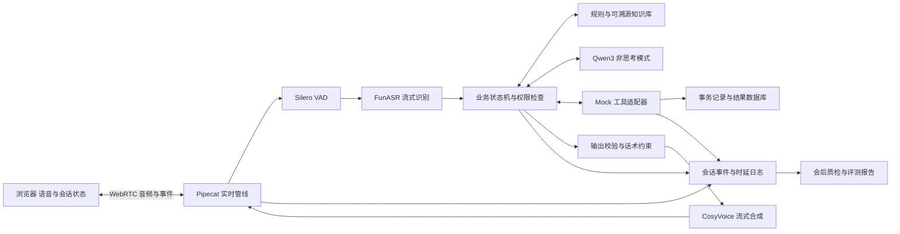

# 智语外呼基线设计文档

版本：v0.4 讨论稿  
日期：2026 年 11 月 7 日  
适用赛题：第二届北京市大学生“人工智能+”创新大赛赛道二，京东智语外呼  
当前状态：完成规则分析与公开项目调研；尚未实现、部署或测得性能。

## 1 设计结论

建议先实现一套可复现、可测量的中文语音外呼基线：**WebRTC 网页端 + Pipecat 实时音频编排 + FunASR 流式识别 + Qwen3-8B 非思考模式 + CosyVoice2-0.5B 流式合成 + 显式业务状态机 + 可追溯检索 + Mock 工具与结构化回写 + 全量质检**。

用户已有服务器上的 A100 80GB，主方案采用服务器自托管开源推理，本地电脑通过浏览器通话，不建议为了基线更换显卡。先以单会话打通、达到规则门槛并冻结 B0 版本，再优化检索、模型、打断和 RSI。8B 是控制延迟与调试复杂度的起点，不代表评测后一定优于更大或更新模型。

这是一份工程设计，不是已经达标的声明。下文“规则要求”来自赛题原文，“建议目标”和资源预算是团队实现时需要验证的假设；GitHub 项目和论文为技术依据，不提供本系统的实测成绩。

## 2 依据与规则边界

### 2.1 本地资料

资料目录：`E:\鹅滴大学\大三\上学期\Ai+\赛题\02“智语外呼”—语音外呼客服数字员工实时语音交互与自主进化`。

- R1：《“智语外呼”-赛题规则.pdf》，8 页。第 5 页为基础门槛，第 6 页为评分维度与数据边界，第 7 页为推荐技术栈与资源支持，第 4 页为提交材料。
- R2：《[POP资审]资审关单场景话术V1.0.xlsx》，**只有 1 个可见工作表“场景汇总”**，作为基线制度与关单方式的导入来源。文件内部另有 3 个隐藏表：“工作表1”“京麦驳回场景”“电话场景”；仅作为历史参考保留，不默认纳入当前规则库。已核对工作簿的 visible/hidden 状态。
- R3：《驳回外呼QA.xlsx》，3 个工作表，提供开场话术、追问问答与特殊场景。
- R4：《赛题数据说明.docx》，解释业务背景和数据特点。说明与原始表格有数值差异，不能直接把说明中的统计作为校验真值。

公开入口：[官方赛题页面](https://bjcsaiic.zsyqkj.com/topics/2026/2)。本设计以用户提供的规则全文为依据；后续如有官方更新，应重新核对。

### 2.2 必须通过的三项门槛

1. 浏览器端不少于 3 轮连续实时语音对话，端到端首字响应时延 **P50 ≤ 2 秒**。
2. 至少完成一个外呼闭环：自报身份、确认对方身份、需求确认、方案沟通、结果确认、结构化回写。
3. 无严重合规违规，包括虚假承诺、诱导、隐私泄露和禁用话术。

规则未在当前材料中公布各评分维度的数字权重，也未给出 P95、打断时延等数值门槛。不得自行编写“官方权重”或把内部目标标成官方要求。

### 2.3 技术与交付边界

- Python/Node.js、WebRTC + JavaScript/TypeScript、Whisper/FunASR 类 ASR、CosyVoice/GPT-SoVITS 类 TTS 均为**推荐而非强制**；允许等价云服务和任意开源或商业大模型。
- Function Calling 与 MCP 是可选工具调用方式，基线采用 Function Calling，不需要为使用 MCP 而增加服务。
- 允许开源框架与预训练模型，必须注明来源、版本和许可证；不能用成品商业外呼机器人代替核心工作。
- 只使用脱敏或合成业务数据，不向真实号码外呼，不自行爬取业务数据。网页内模拟外呼，不接入 SIP/PSTN。
- 企业资料仅限比赛，不公开上传到 GitHub。公开技术项目调研与企业业务数据严格分开。
- 规则要求源代码、可运行说明、一键启动脚本或 Dockerfile、技术方案书、演示视频、自测报告及组件清单。视频不超过 5 分钟；现场系统演示约 3 分钟。
- RSI 可后置，但第 4 页提交清单提到 RSI 前后对比，同分规则也涉及 RSI。**B0 是第一阶段研发基线，不应直接等同最终提交包**；最终是否必须附 RSI 实验应向赛题组确认。

## 3 基线业务范围与数据治理

业务聚焦“京东商城品牌入驻资质审核驳回外呼”。系统接收已经给出的审核原因，解释问题并指导整改，不自主决定商家是否具备真实入驻资格。

第一条贯通场景建议选择“授权书材料不完整”：字段清晰、可解释整改动作，适合验证身份确认、追问、改口、工具写入和回读。B0 冻结前需完成主表全部条目的结构化导入；有冲突或缺失的条目进入待核对队列，不编造补全。

### 3.1 已核对的数据问题

- 按“场景汇总”第 13—80 行有效二级分类统计，共 **68 条，电话 54 条、京麦驳回 14 条**；R4 写成 55/13，与当前工作簿不一致。基线数据检查采用当前表格实数，并保留差异记录。
- “商标状态不符合要求”在可见主表第 13 行标为电话，在隐藏表“京麦驳回场景”第 14 行标为京麦驳回。这是可见表与隐藏内容的差异，不能据此认定当前有效规则相互冲突。基线采用可见主表；隐藏表不参与关单决策。
- 合并单元格使分类字段看似为空。只在对应合并区域中继承分类，不能无条件把整张表向下填充，尤其不能补齐缺失答案。
- 隐藏的“工作表1”含评审批注；不能把它与可见主表合并导入。其他资料中的电话口语与京麦书面话术也需要按用途区分。
- R4 明确提示工号、残缺句、分类错配及占位符不一致。保留来源、版本与人工核对状态，未确认项不得成为强制规则。

### 3.2 数据处理设计

1. 保留原始文件，只读导入，记录文件 SHA-256 和工作表可见性。对 R2 显式设置导入白名单为“场景汇总”，跳过其余隐藏表。
2. 输出三种结构：`business_rules`、`speech_templates`、`faq_entries`，不把所有表格简单拼成一个文本块。
3. 每条记录保留 `source_file`、`sheet`、`row`、`source_version`、`review_status` 和稳定 ID。
4. 统一三级分类与占位符；通过显式映射把 QA 关联到场景，人工复核语义映射。
5. 冲突处理建议：新版官方澄清优先，其次可见主表及已核对的执行层资料。R2 隐藏子表和评审稿不用于补充或覆盖现行规则，除非官方明确确认其适用性。仅对当前有效来源之间的实质冲突进入待核对队列；隐藏历史内容的不同不单独阻塞主表场景。
6. 发票等 QA 独有场景可以进入问答库，但没有明确关单规则时不得猜测执行动作。
7. 实施数据检查：68 条主表分类不丢失、关单方式取值合法、引用位置有效、占位符全部绑定、话术无残缺、内部批注不外显。

### 3.3 关单规则

以主表总原则为基线，保留事件轨迹：默认方式来自场景；商家主动要求回电或出现规定的投诉风险时进入回电分支。首次电话未联系上可走京麦说明；同场景第二次错误且未联系上时建立跟进事件并预约二次外呼，仍未接通再京麦关单；后续第三次及以上按主表规则处理。

上述覆盖规则可能与次数分支发生组合，需要制作真值表人工确认优先级。基线建议“明确回电要求/投诉风险”优先；不确定组合转人工核对。网页内用模拟事件表示未接通和回拨，不实际拨打号码。

## 4 GitHub 优先选型与备选

选择依据依次是：赛题适配、实时能力、可替换接口、可复现部署、许可证清晰度、示例与测试完整性。仓库受关注程度仅作辅助，不将星标数作为质量结论。以下是公开 README、文档与模型卡核对，未完成源码审计或本机性能比较。

### 4.1 实时骨架首选 Pipecat

[pipecat-ai/pipecat](https://github.com/pipecat-ai/pipecat)，代码 BSD-2-Clause。其 Python 管线连接语音、模型和传输层；[SmallWebRTCTransport 文档](https://docs.pipecat.ai/api-reference/server/services/transport/small-webrtc)提供浏览器与 Agent 双向音频及数据通道，无需采购特定实时通信云。

**为什么选：**当前验收是网页单会话外呼，使用轻量 WebRTC 传输能减少初期部署组件；管线结构适合分别测量 ASR、LLM、TTS 时延。**对应要求：**实时语音、浏览器 WebRTC、Python、打断与端到端日志。**仍需开发：**业务状态机、模型适配、真正的停止播放、工具事务与质检；框架接入并不自动满足这些要求。

SmallWebRTC 仍需要运行 Agent 与信令服务，跨网络还需解决 ICE、端口和必要的 TURN；文档中的“serverless”不能理解为不用服务器。基线按本地浏览器连接 GPU 服务器设计，直连能力尚待测试，不能假定同一局域网。赛场不自行架设穿透代理。

### 4.2 实时骨架备选 LiveKit Agents

[livekit/agents](https://github.com/livekit/agents)，框架 Apache-2.0；其 turn detection 模型有独立许可证，应分别核对。项目提供 WebRTC 客户端生态、模型插件、任务调度和测试能力。

**适用：**后续需要多个房间、成熟会话管理或已有 LiveKit 运维经验。**暂不首选：**当前单会话基线可先减少媒体服务部署与管理工作。此为本项目工程取舍，不是认为 LiveKit 性能更差。两套骨架择一，避免同时维护。

[outbound-caller-python](https://github.com/livekit-examples/outbound-caller-python)可参考业务工具调用，但该示例依赖 SIP 外呼；**不照搬电话接入部分**，因为赛题禁止向真实号码外呼。

### 4.3 ASR 首选 FunASR 的流式 Paraformer 路线

[modelscope/FunASR](https://github.com/modelscope/FunASR)，当前仓库标注 MIT；具体模型权重、运行时及依赖许可另行登记。

**为什么选：**与规则点名推荐直接一致，提供中文识别、流式处理及配套 VAD/标点能力。**对应要求：**流式 ASR、业务术语识别、完整转写。**初始方案：**锁定流式模型，不把离线高精度模型直接当实时识别器；最终转写可另做离线复核，但不能让复核阻塞语音首响。热词功能应按实际选定模型与运行时验证，不能假定所有流式后端都支持。

FunASR 与 Pipecat 的采样率、音频分块、partial/final 事件和取消协议需要适配；应估入开发工作量。中文公司名、品牌名、授权、京麦等术语单独建立测试集。

### 4.4 VAD 首选 Silero VAD

[snakers4/silero-vad](https://github.com/snakers4/silero-vad)，MIT。负责语音开始/结束候选检测，适合先在 CPU 运行，避免占用推理显卡。

**对应要求：**端点检测、随时打断。**局限：**VAD 检测语音活动，不负责回声消除，也不能单独保证双讲时准确区分人声。浏览器开启回声消除和降噪能力，配合耳机、实际噪声测试和误打断指标。

### 4.5 TTS 首选 CosyVoice2-0.5B

[CosyVoice 仓库](https://github.com/QwenAudio/CosyVoice)（原 FunAudioLLM 地址当前重定向至此），代码 Apache-2.0；[CosyVoice2-0.5B 模型卡](https://huggingface.co/FunAudioLLM/CosyVoice2-0.5B)标注 Apache-2.0。

**为什么选：**规则点名推荐，CosyVoice 2 有流式合成论文支持，0.5B 规格适合建立可控制的固定基线。**对应要求：**自然语音合成、分块输出与首响优化。采用预先授权的固定音色，不做身份声音克隆。模型卡可能同时介绍更新系列，不能把 CosyVoice 3 的所有能力归到 2.0。

[GPT-SoVITS](https://github.com/RVC-Boss/GPT-SoVITS)，代码 MIT，也是规则推荐候选。其少样本音色能力可用于后续音质实验；基线没有定制音色需求，暂不增加第二套 TTS。是否切换由相同中文脚本的首包、可懂度与稳定性实测决定。

### 4.6 LLM 首选 Qwen3-8B 非思考模式

[QwenLM/Qwen3](https://github.com/QwenLM/Qwen3)及[Qwen3-8B 模型卡](https://huggingface.co/Qwen/Qwen3-8B)，Apache-2.0。支持非思考模式与工具调用路线。

**为什么选：**中文业务沟通、本地部署和工具调用需求匹配；8B 为语音组件与缓存留出空间。**对应要求：**意图、槽位、追问、工具调用、长会话管理。实时路径关闭思考输出，结构化动作由 Schema 校验，模型没有任意执行权。非思考配置参考[官方说明](https://github.com/QwenLM/Qwen3/blob/main/docs/source/getting_started/quickstart.md)。

使用 vLLM 提供独立推理服务；需验证所锁定版本的工具调用解析与结构化输出兼容性。后续可比较 14B、32B 或更新模型，但必须记录任务成功率提升与延迟代价，不能以“显存能放下”作为升级理由。

### 4.7 检索、业务与评测

- [rank_bm25](https://github.com/dorianbrown/rank_bm25)，Apache-2.0：先用三级分类过滤、业务词典及中文字符二元组分词后的 BM25 检索，Top-3 证据进入回答。中文分词由我们实现并验证，库本身不会自动处理。小型资料库先不部署独立向量数据库；同义改写召回不足时再加向量检索和重排。
- 业务服务建议 Python + FastAPI + Pydantic，持久化先用 SQLite；单会话基线无须 Kubernetes、消息队列或多 Agent。HTTP 接口及校验由团队实现，交付前补齐这些基础依赖的精确版本与许可证。
- [sierra-research/tau-bench](https://github.com/sierra-research/tau-bench)，MIT：借鉴用户模拟、工具环境、最终数据库状态检查。我们自建资审场景评测，不把其零售/航空得分当作本赛道成绩。

## 5 系统架构与关键行为



### 5.1 业务状态机

`待任务 → 获取单据 → 判定联系策略 → 自报身份 → 确认身份 → 确认交流意愿/需求 → 解释原因与整改 → 追问与纠错 → 确认结果 → 写回并核验 → 礼貌结束`。

任意状态可以进入拒绝沟通、身份不符、未知问题、投诉升级、接口失败、网络中断等分支。关键动作受代码守卫控制：

- 身份确认前不得披露具体申请、品牌或审核细节；对方否认身份则停止业务说明并记录误接。
- 听到“不方便”时询问可联系时间；明确不愿继续则结束，不循环劝说。
- “补了就一定通过吗”只能解释复审流程，不保证审核结果。
- 结果确认不能从沉默或“嗯”自动推断；必要时简短澄清。
- 多轮记忆保存结构化槽位、工具回执和最近对话，摘要不能覆盖已确认事实。改口产生字段新版本并重新确认。
- 会话最多重问次数、工具步数与等待时间均配置化，达到上限进入明确兜底。

### 5.2 打断必须贯穿整个链路

检测到有效用户发声后，立即增加 `generation_id`，取消旧 LLM/TTS 任务，清空未播放音频，并通知客户端停止旧代音频。取消后迟到的文本、音频、工具提案都按旧 ID 丢弃。

对话记忆只保留已播放内容与明确的中断标记；不能把全部已生成文本当作用户听过。先用句段级播放确认实现保守记录，句内播放对齐留作优化。

工具写入与音频取消分开管理。已经提交的事务不能因打断假装撤销，应查询回执后继续解释；未提交的旧动作丢弃。用户插话与接口重试同时发生时，也不能重复登记工单。

### 5.3 知识问答与输出校验

把制度事实、工具返回和用户表达分别标记。检索结果只提供证据，不能作为覆盖系统策略的指令。检索无可靠证据或出现版本冲突时，说明需要核实并转人工/登记咨询。

关键业务句由已核对模板和结构化字段组成；开放式追问由 LLM 基于证据简短回答。TTS 前按完整语义句段做禁语、隐私、数字、占位符与依据校验，禁止未经检查逐 token 播放。句段检查会增加等待，需要计入时延预算。

必须区分“计划说过”“已合成”“已实际播放”。必说话术被打断时，下轮补齐必要信息；质检依据播放事件与录音，不能只查生成文本。

## 6 工具接口与结果模型

以下是本项目建议接口，并非已经取得的官方 Mock API。企业接口到位后通过适配层映射，不改变业务核心。

- `get_case(case_id)`：读取合成单据、审核原因、提交次数、联系历史。
- `get_contact_policy(case_id)`：规则层给出电话/京麦/待核对及证据。
- `lookup_knowledge(query, scene_id)`：返回来源和已核对的答案要点。
- `create_followup(case_id, reason, appointment, idempotency_key)`：记录回访或人工接管请求。
- `write_outcome(case_id, case_version, outcome, idempotency_key)`：写入联系结果和处理动作。
- `get_operation(operation_id)`：核验写入结果，处理超时后状态未知。

建议结果字段：

```json
{
  "session_id": "synthetic-session-001",
  "case_id": "synthetic-case-001",
  "case_version": 1,
  "identity_status": "confirmed",
  "contact_status": "connected",
  "scene_id": "reviewed-scene-id",
  "reason_codes": ["missing_authorization_material"],
  "required_actions": ["补齐已确认缺失材料后重新提交"],
  "merchant_response": "will_resubmit",
  "needs_human": false,
  "knowledge_refs": ["reviewed-entry-id"],
  "writeback_status": "pending",
  "operation_id": null
}
```

枚举、长度、时间与引用均做类型检查。由服务端生成稳定幂等键；同一逻辑动作重试使用同一个键，参数冲突返回错误。SQLite 中以唯一约束、事务及 `case_version` 检查防止重复写和过期覆盖。

调用失败不能回复“已登记”。超时先查询操作结果，再决定是否重试；业务结果写入与本地完成事件一并落库。外部系统与本地无法单事务提交时，使用持久化待办和对账重试，不宣称已实现跨系统原子提交。

## 7 A100 80GB 部署方案

### 7.1 推荐配置

已确认 A100 80GB 位于服务器。建议在该服务器部署三个独立推理进程或容器：FunASR、Qwen3-8B/vLLM、CosyVoice2，并把 Pipecat、信令、业务服务与知识库放在同机。Linux 是推荐部署系统，实际系统尚待确认。Windows 开发机作为浏览器客户端，负责麦克风采集、音频播放和界面展示，无需本地 GPU。

链路为：本地浏览器 ⇄ WebRTC ⇄ 服务器 Pipecat ⇄ 同机 ASR/LLM/TTS 与业务服务。模型间通信走服务器内部网络，避免每个模型阶段都往返本地电脑。端到端验收必须在真实客户端到服务器的连接上测量，服务器内部跑分快不代表网页通话达标。

部署前先验证以下条件：

- 网页正式访问采用 HTTPS，并正确申请麦克风权限；不能把普通远程 HTTP 地址当作可用语音入口。参见 [MDN getUserMedia](https://developer.mozilla.org/en-US/docs/Web/API/MediaDevices/getUserMedia)。
- 核实服务器公网或校园网可达性、防火墙和 WebRTC 媒体端口。SSH 能登录或网页能打开，只证明相应连接可用，不等于双向音频已经连通。
- 测试 ICE 直连；无法直连时评估获准的 TURN 中继及其延迟、带宽。参见 [WebRTC TURN 文档](https://webrtc.org/getting-started/turn-server)。赛场是否允许该网络部署须提前确认，不能以私设穿透代理解决。
- 测量真实链路的往返时延、抖动、丢包与首响，报告直连或中继方式。网络不可用时明确显示故障，不把预录音频作为实时系统成功结果。
- 模型服务和数据库仅供服务器内部调用，对外提供经鉴权的网页、信令与必要媒体入口。

Qwen3-8B 使用 BF16 起步、非思考模式、单活跃会话，上下文先限制为 8192 tokens，通过结构化记忆控制增长。8B × 2 字节约 16GB 只是权重数量级估算，实际还包括 KV cache、运行时缓冲和其他模型，不能当作实际总显存占用。

资源预算建议：LLM 进程先限制到约整卡 45% 的显存预算，ASR 预留约 8GB，TTS 预留约 12GB，其余留给上下文增长、运行时峰值和余量。**这些是规划额度，不是实测占用或各模型的最低配置**。vLLM 参数参考[官方 engine arguments](https://docs.vllm.ai/en/stable/configuration/engine_args/)，锁定版本后再校验参数语义。

所有服务完成预热后再进入就绪状态；启动时检查模型加载、音频收发、Mock 写入和结果查询。实时会话运行时不在同卡执行训练、批量合成或大规模 Judge 任务。基线阶段不启用复杂 MIG 切分，以免增加资源分配与兼容性变量。

### 7.2 何时才考虑更换或增加算力

- 显存峰值不足：先减小缓存与上下文、限制并发，必要时量化或换小模型。
- TTFT 慢：检查提示长度、排队和网络，再比较更快模型或独立服务。
- ASR/TTS 被 LLM 争抢计算：先限制后台任务并测量进程干扰；确有持续瓶颈再拆卡。
- 8B 业务质量不足：同评测集比较 14B/32B，只有质量增益与时延同时可接受才升级。

服务器部署已确认；用户说明服务器不开放公网，目前通过校园网 SSH 访问。是否为独占 A100、服务器系统、可用 CPU/RAM、校园网内媒体端口与赛场可达性尚待确认。云 API 只保留适配接口；目前没有指定供应商、费用或上传企业材料。

### 7.3 校园网服务器对参赛的影响

当前规则没有要求 GPU 服务器必须对公网开放。校园网内可继续开发和测试，但 SSH 可登录不代表浏览器页面、信令和 WebRTC 双向音频可用，这三项都要独立验证。普通 SSH TCP 端口转发也不能视为整个 WebRTC 媒体链路已打通。

校外赛场若无法访问校园网，则无法依赖当前服务器完成实时演示；这是参赛部署尚未闭环，不是模型选型或显卡容量问题。规则第 4 页要求真实 WebRTC 演示和评委现场打断，第 8 页禁止现场私自搭建外网穿透、代理，不能预设临时使用穿透工具即可解决。

按以下顺序准备比赛环境：

1. 向学校管理员确认是否有正式校外访问方式，以及是否允许网页与实时音频流量；向赛题组确认现场是否允许该方式访问自有远程 GPU。现有学校 VPN 也不能未经确认就视为赛场允许。
2. 若有获准且稳定的访问方式，保留现有 A100 部署，在校外实际网络完整彩排并重测端到端时延。
3. 若无法获准或网络不可达，将同一套容器与模型迁移到比赛可达的受控 GPU 环境；迁移企业材料前核实数据边界。无需因此开放学校服务器的 SSH、模型服务和数据库给整个公网。
4. 若现场不允许依赖远程资源，准备可携带设备上的较小模型配置，先实测确认满足门槛。现有材料未承诺提供评测 GPU，不能假定主办方会提供。

开发继续使用校园网 A100；在比赛网络方案和统一评测部署要求明确前，不能把 B0 标记为“比赛现场可用”。代码与模型路径、网络地址、推理服务配置应可迁移，避免绑定校园网地址。

## 8 时延测量与初始预算

暂定内部口径：从**用户真实结束讲话**到**浏览器开始播放本轮第一段可听且有意义的回复音频**。官方统一工具公布后按其口径报告；LLM 首 token 或服务端 TTS 首包不能直接代替端到端首响。

普通问答轮的初始设计预算为：音频输入与传输 100ms，端点等待 300ms，ASR 收尾 150ms，检索与策略 50ms，LLM 产出可校验首句 450ms，校验及 TTS 首包 300ms，下行与播放 150ms，合计 **1500ms**，预留约 500ms 余量。

上述是一次普通请求的串行近似预算，不是各阶段 P50 相加推得的系统 P50，也不包含额外工具调用的保证。工具轮单独报告完整耗时，不用“好的，请稍等”等垫话掩盖业务响应慢。

内部建议目标：P50 ≤ 1.5s，P95 ≤ 3s；打断后停止可听播放 P95 ≤ 300ms。这些均非官方硬门槛，需在基线数据出来后调整。

记录 `speech_start/end`、`vad_commit`、`asr_final`、`retrieval_done`、`llm_first_token`、`validated_segment`、`tts_first_audio`、`client_play_start/stop`、工具请求及回执时间。跨设备时间做同步或偏移校准；端到端结果优先使用同一采集时钟或官方测量工具验证。

## 9 验收与冻结基线

### 9.1 测试集

建议准备 60 条开发用例与 40 条锁定验收用例。这是初始工作量建议，不是官方数据规模。按场景族、问法和工具故障分层，避免同一句模板的改写同时出现在调参集和验收集。业务知识可以共享，隐藏的是测试对话、用户策略与期望动作。

覆盖正常整改、身份不符、拒绝沟通、改口、重复提问、未知政策、承诺诱导、索取完整第三方号码、提示注入、接口超时、重复写入、噪声与双讲。正确拒绝/转人工属于相应场景的成功结果，不能把所有未关单都算失败。

先做文本状态与工具测试，再做真实浏览器音频测试。至少 20 段语音会话重复 3 次作为初始性能样本，同时报告样本量；冷启动、预热、普通轮、工具轮、噪声轮分组，不能删除超时样本。合成语音辅助扩大覆盖，仍需真人验证口音、插话和拾音。

### 9.2 按评分维度验收

- 实时交互：不少于 3 轮，P50 ≤ 2s；另报 P95、打断成功率、误打断率、漏检、可懂度、双讲和噪声表现。
- 任务完成：最终数据库状态与期望状态一致；记录意图准确率、必填槽位完整率、改口正确率与闭环成功率。
- 知识与工具：答案逐条检查证据；工具名称、参数、前置条件、最终副作用分别判分；重复写入为 0。
- 合规质检：每个完成或异常结束的会话都有报告；严重违规在验收集上为 0。报告区分通过、失败、证据不足，不能把检测器未报警等同绝对安全。
- 工程：干净环境一键启动、固定依赖及模型 revision、可重放日志、失败可恢复；记录单通话推理用量与运行成本。
- 团队协作：推荐按实时语音、业务知识、工具后端、前端评测划分职责，兼岗可合并；最终方案书列出实际成员贡献，不虚构人员信息。

建议内部冻结条件：锁定验收集任务正确率 ≥90%、回写 Schema 合格率 100%、重复副作用 0、全量报告覆盖率 100%，且通过官方三项门槛。90% 是团队目标，不是官方及格线。

### 9.3 全量质检报告

每通报告包含：最终状态、轮数、转写与播放记录、必说项完成情况、禁语及隐私检查、证据引用、工具轨迹、回写回执、分段时延、失败标签和待人工复核项。会话中断也生成报告。

规则评分负责身份步骤、格式、禁语和数据库结果；LLM Judge 辅助评价可懂度、安抚和解释完整性，并用人工样本校准。Judge 不在实时主链路，不能覆盖确定性失败。

## 10 论文依据与适用范围

1. Gao 等，2023，[FunASR: A Fundamental End-to-End Speech Recognition Toolkit](https://arxiv.org/abs/2305.11013)。支持语音识别、VAD 与配套工程工具组合的选型；并不证明当前资料中的品牌词准确率，需业务音频实测。
2. Du 等，2024，[CosyVoice 2: Scalable Streaming Speech Synthesis with Large Language Models](https://arxiv.org/abs/2412.10117)。支持采用流式 TTS 缩短首包等待；论文中的模型延迟不等于包含网络、LLM 和播放的系统时延。
3. Lewis 等，2020，[Retrieval-Augmented Generation for Knowledge-Intensive NLP Tasks](https://arxiv.org/abs/2005.11401)。支持把外部知识作为生成依据；本基线采用较轻的过滤与 BM25，是工程简化，未复现论文训练架构，也不声称检索可完全消除幻觉。
4. Yao 等，2022，[ReAct: Synergizing Reasoning and Acting in Language Models](https://arxiv.org/abs/2210.03629)。支持模型与外部工具交互的思路；基线使用有限工具步数和状态守卫，不在语音路径加入无限推理循环。
5. Yao 等，2024，[τ-bench: A Benchmark for Tool-Agent-User Interaction in Real-World Domains](https://arxiv.org/abs/2406.12045)。支持按最终数据库状态及重复试验评价 Agent 可靠性；其公开任务、指标结果与本赛题不可直接等同。

论文用于解释“为什么采用这种方法”，最终判断仍是本业务与官方未公开测试集上的结果。

## 11 实施顺序与优化边界

以下按验收关卡组织，不先承诺未经团队排期验证的天数。

1. **资料与契约关卡：**整理 68 条主表规则、冲突清单、槽位与 Mock Schema，确定标准成功状态。
2. **文本闭环关卡：**跑通一条资审流程，包含身份不符、追问、拒绝承诺、幂等写回和回读。先证明业务做对。
3. **实时语音关卡：**接入 WebRTC、ASR、LLM、TTS，完成 3 轮语音与播放取消，记录所有分段时延。
4. **异常与质检关卡：**覆盖改口、接口超时、噪声、网络中断及每通报告，达到最低验收要求。
5. **B0 冻结关卡：**锁定代码、容器、模型 revision、提示词、知识库和测试集哈希，输出真实成绩与失败案例。
6. **后续优化：**每次只改变一个主要因素，按同样条件重测；依次考虑领域词表、检索召回、TTS 首包、模型大小和语义端点。
7. **RSI 阶段：**基于 B0 失败类别生成开发用例、提出提示词/策略补丁、自动回归；使用独立保留集，设质量门槛与回滚。不能自动修改合规红线或把锁定验收答案写入系统。

B0 起即保存 `code_version`、`prompt_version`、`knowledge_version`、`model_revision`、`testset_version` 和配置快照，为后续进化提供可信对照。

## 12 待协商项与交付清单

已明确：使用服务器上现有 A100 80GB，目前仅通过校园网 SSH 访问，不开放公网；自托管开源模型，本地浏览器通话。比赛访问方式尚未确定。通过小规模部署试验确定模型与依赖的精确版本，不在未运行前虚构“验证通过版本”。

待协商或待官方澄清：A100 是否独占及网络环境；Pipecat 或已有团队熟悉的 LiveKit；工号是否保留；冲突场景的权威版本；官方 Mock 接口与时延口径；最终提交 RSI 对比的要求。

建议代码结构：`web/` 浏览器；`services/voice/` 音频编排；`services/models/` 推理适配；`domain/` 状态与规则；`tools/` Mock 适配；`evals/` 评测；`data/` 本地资料；`reports/` 私有报告；`docs/` 设计与复现说明。

仓库现有 `data/.gitignore` 会忽略业务数据，应保持；音频、报告、凭据与企业原始材料同样纳入忽略规则。设计文档含赛题业务说明，若计划公开仓库，应先制作不含受限资料细节的公开版。

最终基线交付应包含：可运行源代码、一键启动和健康检查、锁定依赖与镜像清单、模型下载及 revision 清单、许可证文件、脱敏演示任务、测试定义、原始事件日志、指标报告、失败案例和演示视频。许可证表必须区分仓库代码、模型权重、音色素材与第三方依赖。

**下一步建议：用现有 A100 完成“单场景文本闭环 + 三模型首包小测”，用实测验证本方案，再决定是否需要更大模型或更换实时框架。**
